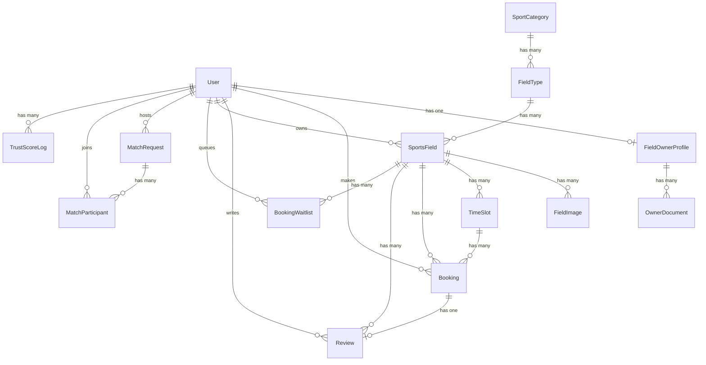

# ⚽ Website Quản Lý và Đặt Sân Thể Thao Trực Tuyến (SportHub)

Hệ thống trung gian kết nối khách hàng có nhu cầu thể thao với các chủ sân bóng đá, cầu lông, tennis, bóng chuyền, bóng rổ. Hỗ trợ tìm kiếm, kiểm tra khung giờ còn trống realtime không cần tải lại trang (AJAX), đặt sân, theo dõi đơn hàng và quản lý doanh thu.

---

## 📌 Các Nhóm Người Dùng & Chức Năng Chính

### 1. ⚽ Khách Hàng (Customer / User)
- **Tài khoản**: Đăng ký, đăng nhập, đổi mật khẩu, xem và cập nhật hồ sơ cá nhân, đổi ảnh đại diện.
- **Tìm kiếm & Lọc**: Tìm sân theo tên/địa chỉ, lọc theo danh mục thể thao (Bóng đá, Cầu lông, Tennis, Bóng rổ, Bóng chuyền), lọc theo loại sân, khoảng giá thuê.
- **Kiểm tra khung giờ realtime (AJAX)**: Chọn ngày để xem các khung giờ còn trống trực tiếp mà không cần reload trang.
- **Đặt sân & Thanh toán**: Gửi yêu cầu đặt sân; sau khi chủ sân duyệt, khách chuyển khoản **đặt cọc 30% hoặc trả hết** vào tài khoản chủ sân theo đúng số tiền và nội dung (mã riêng của đơn) trong 2 giờ, bấm "Tôi đã chuyển khoản"; chủ sân đối chiếu và bấm "Đã nhận tiền" thì đơn mới được xác nhận. Mức cọc và hạn chuyển chỉnh bằng `BOOKING_DEPOSIT_PERCENT`, `BOOKING_PAYMENT_WINDOW_HOURS`.
- **Lịch sử & Đánh giá**: Theo dõi trạng thái đơn hàng (Chờ xác nhận, Đã xác nhận, Đã hoàn thành, Đã hủy/Từ chối), hủy đơn khi đủ điều kiện, đánh giá số sao (1-5⭐) và viết bình luận sau khi sử dụng sân.

### 2. 🏢 Chủ Sân (Field Owner)
- **Quản lý sân bóng**: Đăng bài sân mới, cập nhật thông tin sân, ngừng/bật hoạt động sân, upload nhiều hình ảnh sân bóng.
- **Quản lý giá & Khung giờ**: Cấu hình giá thuê theo giờ và các khung giờ hoạt động.
- **Quản lý đơn đặt**: Xem lịch đặt sân, xác nhận hoặc từ chối đơn đặt, đánh dấu hoàn thành sau khi khách sử dụng.
- **Thống kê doanh thu**: Theo dõi tổng số sân, tổng lượt đặt, lượt đặt theo ngày/tháng, doanh thu theo ngày/tháng, thống kê sân hot nhất.

### 3. 👑 Quản Trị Viên (System Admin)
- **Quản lý tài khoản**: Khóa / mở khóa tài khoản Khách hàng và Chủ sân.
- **Kiểm duyệt chủ sân**: Duyệt hoặc từ chối hồ sơ đăng ký tài khoản chủ sân.
- **Kiểm duyệt sân bóng**: Duyệt sân bóng do chủ sân đăng trước khi hiển thị công khai trên hệ thống.
- **Quản lý danh mục**: Thêm/sửa danh mục thể thao và loại sân.
- **Báo cáo & Giám sát**: Thống kê toàn bộ số liệu hệ thống (doanh thu, đơn hàng, người dùng), giám sát và ẩn các đánh giá/bình luận vi phạm.

---

## 🛠️ Công Nghệ Sử Dụng

- **Backend**: Laravel 13.x (API-only, `/api/v1`), PHP 8.3+, Sanctum (session cookie SPA)
- **Database**: MySQL (mặc định trong `.env.example`) / SQLite
- **Frontend**: React 19 + Vite + TypeScript (thư mục `frontend/`), TanStack Query, Leaflet
- **Phân quyền**: `admin` và `customer`. Chủ sân là `customer` có hồ sơ chủ sân đã duyệt (`field_owner_profiles.verification_status = approved`)
- **Hàng đợi & lịch chạy**: queue `database` (gửi mail) và scheduler (đóng đơn quá hạn, phạt no-show, hết hạn lời mời waitlist)

---

## 🗄️ Sơ Đồ Quan Hệ Dữ Liệu (ERD)



---

## ⚙️ Hướng Dẫn Cài Đặt Dự Án (Installation Guide)

### 1. Yêu cầu hệ thống
- PHP >= 8.3, Composer 2.x
- Node.js 20+ và NPM
- MySQL 8 (hoặc SQLite nếu đổi `DB_CONNECTION` trong `.env`)

### 2. Cài đặt (chạy local)

```bash
cp .env.example .env            # chỉnh DB_* cho khớp MySQL local (mặc định database `sporthub`)
composer install
php artisan key:generate
php artisan migrate:fresh --seed   # tạo bảng + dữ liệu demo
php artisan storage:link           # để xem ảnh upload

npm install                      # công cụ chạy song song (concurrently)
npm --prefix frontend install
```

### Cập nhật sau khi `git pull`

Git chỉ chứa mã nguồn và file migration, không chứa dữ liệu DB. Mỗi lần kéo code mới về, chạy thêm:

```bash
composer install
php artisan migrate               # tạo bảng/cột mới (settings, admin_logs, cột thanh toán...), giữ nguyên dữ liệu cũ
npm --prefix frontend install
```

Nếu muốn làm lại DB demo từ đầu: `php artisan migrate:fresh --seed` (xoá toàn bộ dữ liệu hiện có).
Không sửa các file migration đã đẩy lên git; khi cần đổi cấu trúc bảng hãy tạo migration mới.

### 3. Chạy hệ thống

```bash
npm run dev
```

Lệnh này chạy cùng lúc 4 tiến trình:

| Tên | Lệnh | Vai trò |
|---|---|---|
| api | `php artisan serve --port=8011` | Backend: http://127.0.0.1:8011 |
| queue | `php artisan queue:work --tries=1` | Gửi mail (xác nhận đơn, lời mời waitlist, huỷ trận…) |
| schedule | `php artisan schedule:work` | `bookings:sync` (15 phút), `waitlist:expire` (mỗi phút), `matches:close-past` (mỗi giờ) |
| frontend | `npm --prefix frontend run dev` | Giao diện: http://127.0.0.1:5173 |

Backend chạy bằng `php -S` với `upload_max_filesize=20M`/`post_max_size=40M` (xem script `dev:api`), nên không phụ thuộc `php.ini` của từng máy khi tải ảnh. Nếu tự chạy `php artisan serve` thì mặc định PHP chỉ cho 2MB/tệp, 8MB/request; giao diện đã tự nén ảnh lớn trước khi gửi.

Thiếu `queue` thì mail không được gửi; thiếu `schedule` thì đơn quá hạn không tự đóng, no-show không bị phạt, lời mời waitlist không hết hạn.

### 4. Cấu hình tuỳ chọn
- **Mail**: mặc định `MAIL_MAILER=log` (xem `storage/logs`); ở chế độ này **không bắt xác thực email** để tài khoản mới đặt sân được ngay. Dùng mail thật (Mailpit/SMTP) thì tự bật bắt buộc xác thực, hoặc ép bằng `REQUIRE_EMAIL_VERIFICATION=true`. Dùng Mailpit/ServBay bằng cách đổi `MAIL_*` trong `.env`.
- **Đăng nhập Google**: điền `GOOGLE_CLIENT_ID`, `GOOGLE_CLIENT_SECRET`, `GOOGLE_REDIRECT_URI` trong `.env`. Không commit file `client_secret*.json`.
- **Chạy test**: `php artisan test` (dùng SQLite in-memory, không đụng DB local).

---

## 🔑 Tài Khoản Mẫu Để Kiểm Thử (Dữ Liệu Seeded)

Tất cả tài khoản mẫu có mật khẩu chung là: **`password`**

| Vai trò | Email đăng nhập | Mật khẩu | Mô tả & Quyền hạn |
|---|---|---|---|
| **System Admin** | `admin@sportfield.com` | `password` | Quản trị viên tối cao: Kiểm duyệt sân, kiểm duyệt chủ sân, khóa user, quản lý danh mục |
| **Field Owner 1** | `owner1@sportfield.com` | `password` | Chủ sân CLB Thể Thao Tây Vương (Sân bóng đá, cầu lông, tennis) |
| **Field Owner 2** | `owner2@sportfield.com` | `password` | Chủ sân Khu Phức Hợp Sao Mai (Bóng rổ, bóng chuyền) |
| **Field Owner 3** | `owner3@sportfield.com` | `password` | Chủ sân Cầu Giấy Pro (Tài khoản đang chờ Admin duyệt) |
| **Customer 1** | `customer@sportfield.com` | `password` | Khách hàng Lê Văn Khách |
| **Customer 2** | `customer2@sportfield.com` | `password` | Khách hàng Phạm Hoàng Nam |
| **Customer 3** | `customer3@sportfield.com` | `password` | Khách hàng Vũ Thị Hương |
| **Customer 4** | `customer4@sportfield.com` | `password` | Khách hàng Đặng Anh Khoa |
| **Customer 5** | `customer5@sportfield.com` | `password` | Khách hàng Ngô Bảo Long |

---

## 🧪 Chạy Kiểm Thử Tự Động (Automated Testing)

Dự án tích hợp sẵn bộ kiểm thử tính năng (Feature Tests) với PHPUnit / Laravel Test:

```bash
php artisan test
```

---

## 📜 Giấy Phép (License)

Dự án đồ án học thuật mở rộng phát triển trên nền tảng Laravel Framework ([MIT License](https://opensource.org/licenses/MIT)).
